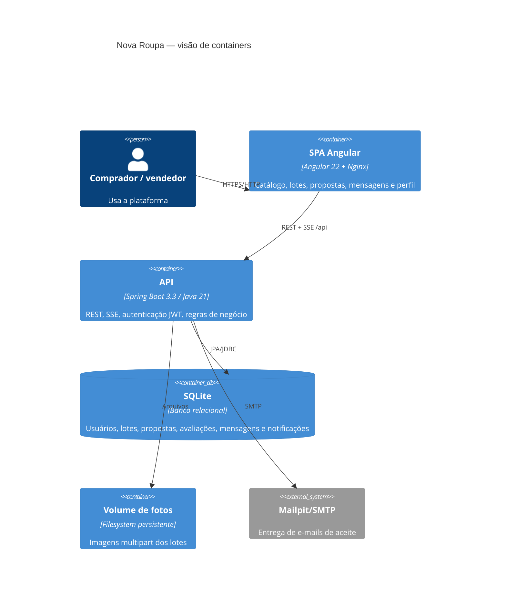
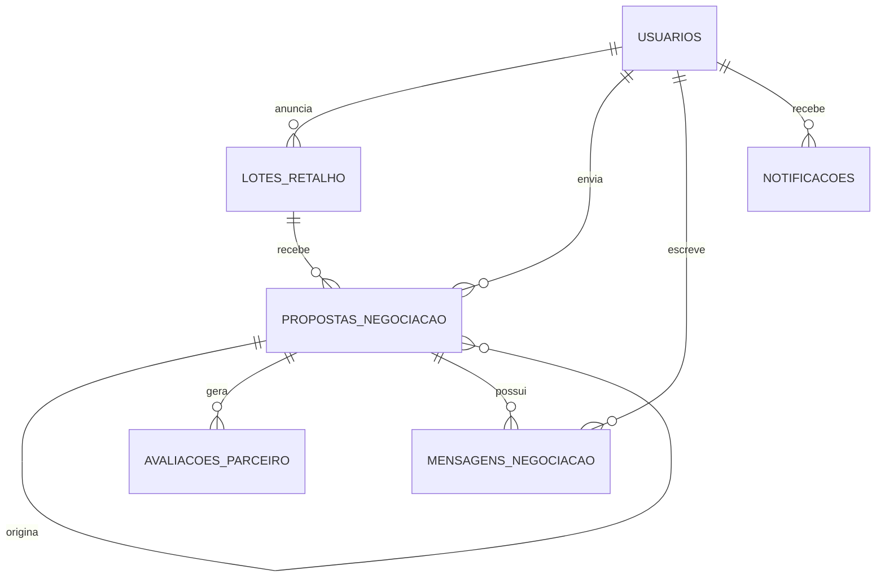

# Arquitetura do Nova Roupa

## C4 — containers

## Modelo de dados

## Portas e volumes

| Serviço | Porta | Finalidade |
|---|---:|---|
| Frontend/Nginx | 4200 | SPA e proxy `/api` |
| API | 8080 | REST, Swagger e Actuator |
| Mailpit UI | 8025 | Caixa de entrada local |
| Mailpit SMTP | 1025 | SMTP local |
| SQLite/fotos | volume `nova-roupa-data` | Persistência |
